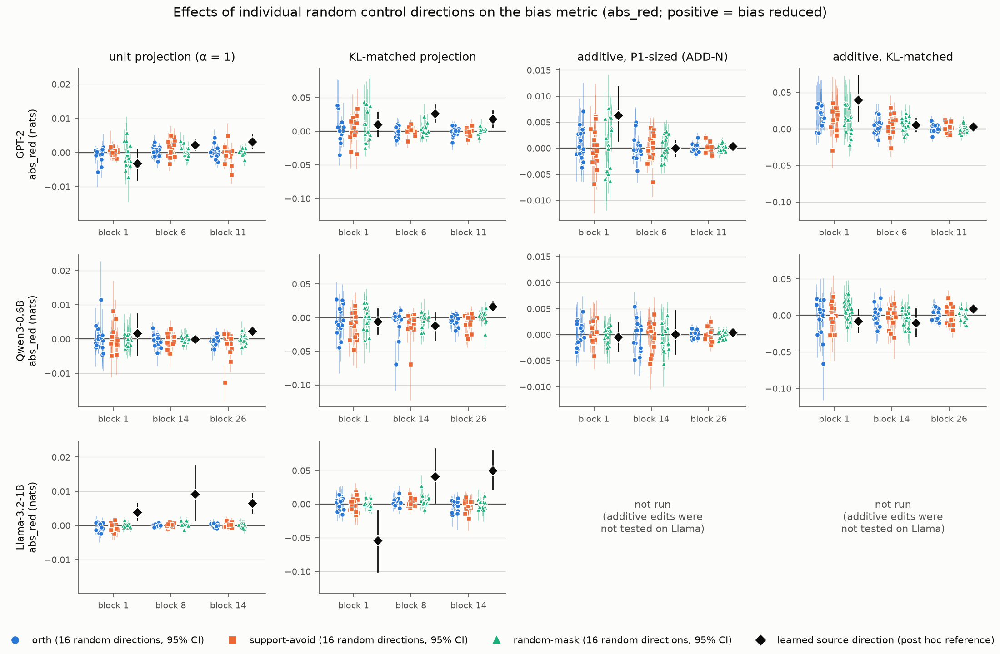

# Pin the Vector, Test the Control: Provenance Gates and Random-Direction Baselines for Activation Interventions

Panteleimon-Panagiotis Christou (independent)

Code, pre-registration and pinned ledgers: https://github.com/Pantelis23/direction-provenance-gates

## Abstract

Claims about activation interventions are claims about specific direction vectors, and about the random directions used as their controls. We test both. First, we give a small provenance protocol that stores each direction as a hashed, hermetically copied artifact, and evaluate it by injecting 13 realistic faults into a real experiment. A hardened self-contained integrity gate catches 12 (the original caught 6). The 13th, a run silently redone end to end, is caught only by a hash ledger pinned outside the run. A common regenerate-then-verify CI step catches 2. Second, in a pre-registered study on GPT-2, Qwen3-0.6B and Llama-3.2-1B (three blocks each, 16 random directions per control and condition), random directions are not reliably null controls. With a heterogeneity test we calibrated on the real data (the pre-registered χ² test proved anticonservative, rejecting true nulls 17–23% of the time), random edits matched to a fixed general-text KL budget are heterogeneous in 23 of 27 cells, and additive edits in 27 of 36. Plain unit projections are null at the first block of every model but heterogeneous deeper in (14 of 27 cells overall). The learned bias direction itself beats all 48 of its random controls in only 9 of 30 condition cells. Support-avoiding and subspace-matched random directions behave like unconstrained ones, and Jacobian-lens propagation does not predict which directions matter. Finally, regenerating directions reproduced every hash on the same machine seven months later, but not on different hardware, where vectors shifted by a few float32 ULPs while results agreed to 10⁻⁶. Stored vectors, not regenerated ones, are what should be pinned.

## 1. Introduction

A direction-based intervention edits a hidden state h along a unit vector d. Claims about such interventions are claims about a specific d: "projecting out d reduces bias", "a random direction of equal cost does not". Those claims are only checkable if the exact d used in each run can be recovered later. In practice d is often regenerated from a seed, loaded from a path relative to whatever the working directory happens to be, or reconstructed by a later "backfill" script from generator code that may have changed.

None of these failure modes crash anything. The experiment still runs, the numbers still look plausible, and nothing tells you that the vector in the table is not the vector that produced it.

This paper makes three contributions. All code, the pre-registration with its dated addenda, the pinned ledgers and the fault-injection harness are public at https://github.com/Pantelis23/direction-provenance-gates.

1. **A provenance contract for direction vectors** (Section 3): canonical float32 unit vectors, a semantic hash of the payload, hermetic copies inside each run's output, and a ledger of hashes pinned in version control.
2. **A fault-injection evaluation of the gates** (Section 4): 13 injected faults, showing what a self-contained integrity gate can and cannot catch, and that a common CI pattern (regenerate the manifest, then verify it) catches almost nothing.
3. **A pre-registered test of the random-direction control** (Section 5): in GPT-2, Qwen3-0.6B and Llama-3.2-1B at three depths each, with removal and additive edits, size-matched by norm or by a fixed general-text KL budget, and with every vector run through the gates of Section 3. Random directions turn out not to be reliably null except as small edits at the first block. Along the way we found that the standard χ² heterogeneity test is anticonservative in this design, and we replaced it with a calibrated joint block bootstrap.

## 2. Related work

**Direction-based interventions.** Linear directions in activation space are used to steer generation (Turner et al., 2023, *Activation Addition*; Li et al., 2023, *Inference-Time Intervention*; Zou et al., 2023, *Representation Engineering*) and to remove concepts (Ravfogel et al., 2020, *INLP*; Elazar et al., 2021, *Amnesic Probing*; Belrose et al., 2023, *LEACE*). Gender directions in embeddings go back at least to Bolukbasi et al. (2016). These works establish methods; none of them specifies how the resulting vectors should be stored and verified across runs.

**Controls for interventions.** Random-direction baselines are the standard control for directional effects, size-matched either on norm or on some behavioural cost. Anthropic (2026) report that matched-norm random perturbations leave behaviour near baseline, while edits in a small subspace of verbalizable directions do not. Section 5 tests when the random-control premise holds in open models.

**Reproducibility tooling.** Experiment trackers and data-versioning tools (e.g. MLflow, DVC) and reporting standards (Pineau et al., 2021; Mitchell et al., 2019; Gebru et al., 2021) record configurations, code versions and datasets. Our protocol is narrower and complementary: it pins the exact vector payloads that an intervention applied, and it is evaluated against injected faults, not just described.

## 3. Protocol

### 3.1 Threat model

We target accidental, silent integrity failures:

| threat | example |
|---|---|
| silent regeneration | seed handling or generator code changes, or the same code on different hardware (§5.5); a "rerun" produces a different d |
| path drift | a relative path later resolves to a different file |
| backfill ambiguity | a post-hoc script reconstructs d from a generator instead of loading the stored vector |
| corruption / swap | truncated write, wrong file copied into the right name |
| incomplete runs | a control record or a whole seed summary missing, so a glob silently matches fewer files |

We do not defend against deliberate falsification, and we do not guarantee bit-exact numerical reproducibility across BLAS/driver versions. We guarantee that the vector recorded is the vector on disk, and that the set of vectors has not changed since it was pinned.

### 3.2 Direction contract

Every direction is stored as a 1-D float32 array with unit L2 norm. Its semantic hash is `sha256(d.astype(float32).reshape(-1).tobytes())`, which is independent of `.npy` header details. Each per-control record in a run summary stores this hash and two paths (a canonical `direction.npy` and a control-named alias). The matched-cost driver additionally copies both files into the run's own output directory (`directions/{control}.direction.npy`, `directions/{control}.direction_control.npy`) and records those hermetic paths. The field-level schema is in `docs/provenance.md`.

### 3.3 Gates

**Integrity gate** (`scripts/check_direction_integrity.py`). For every record it checks that:
- the hermetic copies exist (no silent fallback to the original run directory)
- the canonical file is float32, 1-D, finite and has unit norm
- its semantic hash matches the recorded hash, and the record-level and nested hashes agree
- the alias is byte-identical to the canonical file
- every expected control appears exactly once, and the expected number of seed summaries is present

All of these compare the run against metadata the same run wrote.

**Pinned ledger** (`ledgers/artifacts_newartifact.json`, checked by `scripts/check_artifacts_manifest.py`). It stores raw hashes of every seed summary and hermetic direction file, plus the recorded semantic hashes and support statistics. It is committed to git. CI verifies against it and never regenerates it; updating it requires an explicit `UPDATE_LEDGER=1`, which then shows up in `git diff`.

### 3.4 Support-avoid invariants

One of the controls in Section 5 is a random direction that avoids the source direction's *support*: the top-k coordinates of |source|. Checking this by comparing top-k index sets is fragile, because ties at the k-th value make the overlap depend on sort order. Instead we check two invariants that do not depend on the candidate vector's own ranking:
- `masked_support_mass = sum(|v[S]|) / sum(|v|) == 0`
- `support_intrusion_frac_eps = mean(|v[S]| > eps) == 0`, where `eps = 8 · float32_eps · max|v|`

Here S is the source's top-k set. S is itself computed with `argpartition` and so breaks ties arbitrarily; the generator and the checker use the same routine on the same array, so they agree, but S is not tie-invariant in an absolute sense. These invariants hold by construction for the support-avoid generator; their value is catching a changed or swapped generator.

## 4. Evaluating the gates by fault injection

`scripts/fault_injection.py` copies a clean 4-seed, 2-control run (8 direction records) into a sandbox, pins a ledger, applies one fault, and runs three checks: the integrity gate, the CI step as originally written (regenerate the manifest from the current files, then verify against it), and verification against the pinned ledger.

| fault | integrity gate, original | integrity gate, hardened | CI: regenerate + verify | pinned ledger |
|---|---|---|---|---|
| none (false-alarm check) | pass | pass | pass | pass |
| direction regenerated, both copies overwritten | caught | caught | missed | caught |
| one bit flipped in payload | caught | caught | missed | caught |
| `.npy` truncated | caught | caught | missed | caught |
| two controls' files swapped | caught | caught | missed | caught |
| alias diverged from canonical | caught | caught | missed | caught |
| hermetic copies deleted (originals remain) | **missed** | caught | caught | caught |
| all copies deleted | caught | caught | caught | caught |
| run redone end to end (vector + summary hash) | **missed** | **missed** | missed | caught |
| non-unit vector with self-consistent hash | **missed** | caught | missed | caught |
| record-level vs nested hash conflict | **missed** | caught | missed | caught |
| one control record dropped | **missed** | caught | missed | caught |
| empty results list | **missed** | caught | missed | caught |
| whole seed summary deleted | **missed** | caught | missed | caught |
| **caught (of 13 faults)** | **6** | **12** | **2** | **13** |


*Figure 1. Which check catches which injected fault. Each cell is labelled, so the figure does not rely on colour.*

Three lessons:

1. **Silent fallbacks defeat hermeticity.** The original gate, on finding a hermetic copy missing, quietly checked the original run-directory file instead, and passed.
2. **Self-contained checks have a ceiling.** Any check that compares a run against metadata written by the same run cannot detect the run being consistently redone. That fault needs a reference that was fixed earlier and stored elsewhere.
3. **Regenerate-then-verify is a tautology.** It proves the files match themselves. It only catches faults that make generation itself fail.

The pinned ledger catches everything here, but only relative to the moment it was pinned: a fault present at pinning time (for example, a non-canonical vector) is pinned along with it. That is why the canonical-form check belongs in the integrity gate rather than only in the ledger.

**Keeping the gate honest.** The detection matrix above is committed (`ledgers/fault_injection_expected.json`), and `ci_gates.sh` re-injects all 13 faults on every run and fails if any detection changes. Dropping a single integrity flag turns CI red, naming the faults that would slip through.

## 5. Are random control directions null?

Random directions are the default control for directional interventions: if a learned direction d changes behaviour and a random direction "of the same size" does not, the effect is attributed to d. We test that premise in three models, at three depths each, under three ways of making a random edit "the same size". The hypotheses and decision rules were pre-registered before the runs they concern: `docs/prereg_2026-09-28.md`, committed at `dfb4e33`, with the Qwen addendum at `d490967`, the KL-matched addendum at `1597fa6`, the additive-steering addendum at `b8b1c63`, and the Llama addendum at `6bf51bf`. The joint block-bootstrap test of §5.3 and the effect-size reference runs are post hoc and are labelled as such. Every vector reported here passed the gates of Section 3.

### 5.1 Setup

**Data.** Sentences follow templates such as "{name} works as {article} {job}." for 5 gendered name pairs (John/Mary, Michael/Jennifer, …), 56 occupations and 8 templates. Each is paired with a neutral baseline ("{name} works as a person.").

**Bias metric.** For a name pair, the bias is the difference in average token log-probability between the male-name and the female-name sentence, minus the same difference for the baseline template. An intervention's effect is `abs_red = |bias_before| − |bias_after|`, in nats per token. It is averaged over held-out (template, job) blocks (a fixed 5% split), and positive means the bias magnitude shrank. CIs are 95% block-bootstrap intervals (5,000 resamples).

**Intervention.** At one block, on non-name tokens: h ← h − α (h·v) v, applied to the block's output (the residual stream).

**Source directions.** Per block, a ridge-regression direction (λ = 1) predicts a name pair's baseline-adjusted bias from the difference of the two sentences' mean-pooled hidden states. It was trained with a 30% block holdout using the same block hash as the evaluation split, so the evaluation blocks are unseen. No control ever applies the source; it only defines what the controls are orthogonal to and which coordinates they avoid.

**Controls.** One direction per seed (1–16) and control:
- `orth`: Gaussian random, orthogonalised to the source.
- `support-avoid`: Gaussian random on the coordinates *outside* the source's top-512 |coordinates|, orthogonalised to the source. In GPT-2 that leaves 256 of 768 coordinates.
- `random-mask`: the same construction with 512 coordinates masked uniformly at random. It matches support-avoid's dimensionality but not its avoidance.

**Models and blocks.** GPT-2 small (Radford et al., 2019; 12 blocks, d = 768) at blocks 1, 6 and 11. Qwen3-0.6B (Yang et al., 2025; 28 blocks, d = 1024, weights sha256 `f47f7117…`) at blocks 1, 14 and 26. Llama-3.2-1B-Instruct (Grattafiori et al., 2024; 16 blocks, d = 2048, via the mirror `unsloth/Llama-3.2-1B-Instruct` @ `5a8abab4`, weights sha256 `1ff795ff…`) at blocks 1, 8 and 14. All run in float32. Llama prepends a beginning-of-text token, so its sentence scores also include predicting the name. The edit never touches that position, and the baseline adjustment largely cancels the name prior, but absolute bias levels are not strictly comparable across models.

**A disclosed flaw.** In Hugging Face models the last entry of `hidden_states` has the final normalisation applied. The original GPT-2 block-11 source direction was learned on that post-`ln_f` state but is applied to the pre-`ln_f` block output, where `ln_f`'s per-coordinate gain ranges from 0.004 to 17.4. At block 11, "orthogonal to the source" and "the source's top-512 support" are therefore defined in the wrong space. This does not affect whether random directions are null, but it weakens any support-avoid interpretation there. All other source directions are learned and applied in the same space, which is why Qwen uses block 26 rather than its last block, 27.

### 5.2 Three ways to make a random edit "the same size"

- **Unit projection (P1).** α = 1: a true projection of v out of the residual stream, with no calibration. This is the closest analogue to the matched-norm controls in Anthropic's J-space work (Section 6).
- **KL-matched (KL), the primary matched condition.** α is calibrated per direction so that the edit costs exactly the same general-language damage everywhere: mean next-token KL(original ‖ edited) = 0.10 nats per position (±5%), over every position of 100 WikiText-103 test paragraphs with the edit applied at all positions. The target is the same for every model, block, seed and control. It was chosen from a cost-only pilot on seeds 101–102, before any effect was measured (addendum B). The KL-to-original criterion follows heretic (p-e-w/heretic @ `3521f86`), which scores only the first generated token. The corpus is disjoint from the bias sentences, and KL is zero only for a no-op edit.
- **PLL-matched (MC), pre-registered but flawed, secondary.** α is calibrated so that the drop in log-probability of the bias sentences themselves matches a per-seed target. Two flaws surfaced (addendum B). This cost counts only log-prob *drops*, so on 3 of 16 seeds at GPT-2 blocks 1 and 6 the target fell below the matching tolerance and α = 0 counted as "matched" (15 vacuous matches in all). Targets also vary 10–60× across seeds, which confounds across-direction spread with seed-level cost (|effect| vs target: ρ = +0.43, p = 0.007 at block 1). We report MC only at GPT-2 block 11, where legacy targets left no vacuous matches. The Qwen MC run was stopped after 4 seeds.

Matched α values are well above 1 (KL: 0.7–24.0; MC at block 11: 1.05–29.8), so matched edits reverse and amplify the component along v rather than removing it.

**Additive edits** (addendum C). Projections *remove* a component; steering and the J-space controls mostly *add* one. With the same random directions, we therefore also ran h ← h + α v:
- **ADD-N (matched displacement):** one fixed α per block, equal to the pilot median of E|h·v| on WikiText. That is the typical displacement a unit projection makes along a random direction, so ADD-N is P1's additive twin. It is a gentle edit: KL is about 0.001–0.006 nats per position, interpolated from the pilot's α grid.
- **ADD-KL:** α calibrated to the same fixed KL = 0.10 nats per position as the KL condition, with per-block α ceilings fixed from a cost-only pilot.

### 5.3 Statistics

Per control and condition we report the mean effect over the 16 directions, the mean |effect|, Cochran's Q (with each direction's block-level SE) and the DerSimonian–Laird between-direction SD τ. Between controls we use paired sign-flip permutation tests (`scripts/analyze_mc_controls.py`).

**Which test of heterogeneity.** The pre-registered test compared Cochran's Q with its normal-theory null, which is a χ² distribution with 15 degrees of freedom. Two features of this design threaten that null. First, all 16 directions are evaluated on the *same* held-out split, so their errors can covary. Second, each direction's SE is estimated from only 26 held-out blocks, whose block means are heavy-tailed. H1 checks that the SEs are right *on average*; it says nothing about either issue. We therefore added, post hoc, a **joint block bootstrap** of Q (`scripts/joint_block_test.py`). Each direction is recentred to its own mean, the 26 blocks are resampled *jointly* for all 16 directions (one shared draw per resample, so any cross-direction covariance from the shared split is reproduced), and Q is recomputed with its SEs re-estimated inside each resample (20,000 resamples). We then checked both tests on synthetic null data, by resampling four real cells' recentred block data, which keeps the real covariance and tails (`scripts/calibrate_homogeneity_tests.py`, 300 null datasets per cell):

| cell (orth control) | χ²-Q false-rejection rate at α = 0.05 | joint-bootstrap Q |
|---|---|---|
| gpt2 P1 L6 | 0.23 | 0.030 |
| gpt2 KL L1 | 0.17 | 0.067 |
| qwen P1 L26 | 0.20 | 0.037 |
| gpt2 MC L11 | 0.18 | 0.043 |

The pre-registered χ² test is **anticonservative**: it rejects a true null 17–23% of the time instead of 5%. The joint bootstrap is calibrated (3–7%). The mean cross-direction correlation of the recentred block data is close to zero in almost every cell (|r̄| ≤ 0.15 in 81 of 93 cells, with a maximum of 0.54), so the shared split itself contributes little. The miscalibration comes from the χ² tail with SEs estimated from 26 heavy-tailed blocks. **All p-values below are from the calibrated joint bootstrap.** The pre-registered χ² p-values are listed alongside for transparency, and the hypothesis table reports both verdicts.

**Jacobian-lens propagation (H4).** For GPT-2 blocks 1 and 6 we fit a Jacobian lens (anthropics/jacobian-lens @ `581d398`) on 300 WikiText-103 paragraphs (Merity et al., 2017) of up to 128 tokens. J_ℓ is the average Jacobian of the final residual with respect to the block-ℓ residual. For a unit direction v, A(v) = ‖J_ℓ v‖ measures how strongly a perturbation along v propagates to the output. At GPT-2 block 11 nothing lies between the edit and `ln_f`, so the lens reduces to the logit lens and A(v) carries no information.

### 5.4 Results

| hypothesis | prediction | pre-registered test (χ²-Q) | calibrated re-analysis (joint bootstrap) |
|---|---|---|---|
| H1 | block-bootstrap SEs are calibrated on average (pooled Q/df within its null band) | **held**: 1.046, band 0.775–1.253 | not affected (H1 is about SE scale; tails are checked above) |
| H3, part 1 | under P1, a majority of cells at early/middle blocks show no heterogeneity | **failed**: GPT-2 0/6 null, Qwen 3/6 | **failed narrowly**: GPT-2 3/6 null, Qwen 3/6 (4 needed) |
| H2-KL | under KL, every cell heterogeneous at the Bonferroni level | **failed narrowly**: 17/18 (25/27 with Llama) | **failed**: 1/27 at Bonferroni; 23/27 at p < 0.05 |
| H3-KL | τ(KL) > τ(P1) in a majority of cells | **held**: 18/18 | **held**: 27/27, Llama included (τ is an estimate, not a test) |
| H4 | J-lens propagation A(v) predicts \|effect\| under P1 (ρ > 0) | **failed**: ρ = −0.20 (block 1), +0.14 (block 6) | unchanged |
| H5 | Qwen3-0.6B replicates H2 and H3 | split into the rows above; its PLL-matched part was superseded with MC by addendum B | (as above) |
| H6 | ADD-N (P1-sized additive edits) is null in a majority of cells | **failed**: 17/18 heterogeneous | **failed**: 14/18 heterogeneous |
| H7 | ADD-KL heterogeneous at the Bonferroni level in every cell | **failed narrowly**: 15/18 | **failed**: 6/18 at Bonferroni; 13/18 at p < 0.05 |

**Pooled evidence.** No single prediction of "every cell past Bonferroni" survives calibration. Pooled across cells, though, the evidence that random directions are not null is overwhelming. If every cell were null, a calibrated test would flag each one with probability at most about 0.067 (the worst rate observed in the null calibration). The observed counts are far above that:

| condition | cells heterogeneous at p < 0.05 (calibrated) | GPT-2 / Qwen / Llama | P(≥ count \| all null) |
|---|---|---|---|
| P1 (unit projection) | 14/27 | 5/9 / 6/9 / 3/9 | 3·10⁻¹⁰ |
| KL-matched projection | 23/27 | 9/9 / 8/9 / 6/9 | 1·10⁻²³ |
| ADD-N | 14/18 | 7/9 / 7/9 / — | 9·10⁻¹⁴ |
| ADD-KL | 13/18 | 6/9 / 7/9 / — | 3·10⁻¹² |

These binomial tail probabilities assume the cells are independent. The cells share held-out blocks across controls and conditions, so treat these probabilities as indicative. The counts themselves need no such assumption.



*Figure 2. Effect of each random control direction (abs_red, nats; positive means the bias magnitude shrank) with its 95% block-bootstrap CI, for 16 directions per control (marker shape and colour), per block. The black diamond is the learned source direction under the same condition (post hoc reference run). Panels in a column share a y-axis. For scale, the mean |bias| before any edit is 0.15–0.17 nats in all three models.*

**Integrity and reproducibility.** All 31 sweeps analysed here (1,488 direction records) pass the hardened gate with `--expect-files 16` and all three controls required, with no issues. Regenerating the 32 original orth and support-avoid directions from their seeds on the same machine, seven months after the legacy sweep, reproduced all 32 hashes. With the legacy cost targets pinned, it also reproduced every effect estimate exactly (maximum difference 0.0). Section 5.5 covers other hardware.

**H1: the SEs are right on average.** Nine fixed directions (GPT-2 block 11, seeds 1–3 × 3 controls) were each re-evaluated on 16 held-out splits, where their true effect is constant. Per-direction Q/df ranged from 0.41 to 1.50, with pooled Q/df = 1.046, inside the 95% band for calibrated SEs. The block-bootstrap SEs therefore have the right scale. As shown above, however, a χ² reference on top of them is too light-tailed.

**Unit projection: null at the first block, not null later.** Under the calibrated test, a plain projection with no amplification is heterogeneous in 14 of 27 cells. The pattern is sharp: at the **first block of all three models only 1 of 9 cells** is heterogeneous, while at the middle and last blocks most are. At early layers, then, random unit projections behave like the null controls they are meant to be, matching the J-space matched-norm finding. Deeper in the network, individual random directions shift the bias metric by real, direction-specific amounts (mean |effect| 0.0003–0.003 nats).

| model | block | control | mean effect | mean \|effect\| | τ | Q/df | p (calibrated) | p (χ², pre-reg.) |
|---|---|---|---|---|---|---|---|---|
| GPT-2 | 1 | orth | −0.0006 | 0.0013 | 0.0008 | 2.56 | 0.1154 | 0.0009 |
| GPT-2 | 1 | support-avoid | +0.0001 | 0.0007 | 0.0006 | 2.05 | 0.1213 | 0.0094 |
| GPT-2 | 1 | random-mask | −0.0011 | 0.0030 | 0.0019 | 4.85 | 0.0524 | < 10⁻⁴ |
| GPT-2 | 6 | orth | +0.0002 | 0.0012 | 0.0010 | 3.76 | 0.0140 | < 10⁻⁴ |
| GPT-2 | 6 | support-avoid | +0.0007 | 0.0019 | 0.0014 | 6.76 | 0.0173 | < 10⁻⁴ |
| GPT-2 | 6 | random-mask | +0.0002 | 0.0010 | 0.0007 | 3.06 | 0.0286 | < 10⁻⁴ |
| GPT-2 | 11 | orth | +0.0001 | 0.0012 | 0.0008 | 4.73 | 0.0036 | < 10⁻⁴ |
| GPT-2 | 11 | support-avoid | −0.0007 | 0.0016 | 0.0010 | 5.50 | 0.0050 | < 10⁻⁴ |
| GPT-2 | 11 | random-mask | +0.0001 | 0.0006 | 0.0004 | 2.52 | 0.0559 | 0.0009 |
| Qwen | 1 | orth | +0.0001 | 0.0026 | 0.0021 | 2.79 | 0.0376 | 0.0002 |
| Qwen | 1 | support-avoid | +0.0001 | 0.0022 | 0.0008 | 1.20 | 0.3765 | 0.2630 |
| Qwen | 1 | random-mask | +0.0001 | 0.0011 | 0.0000 | 0.76 | 0.7339 | 0.7178 |
| Qwen | 14 | orth | −0.0004 | 0.0013 | 0.0011 | 3.49 | 0.0224 | < 10⁻⁴ |
| Qwen | 14 | support-avoid | −0.0005 | 0.0014 | 0.0011 | 3.57 | 0.0288 | < 10⁻⁴ |
| Qwen | 14 | random-mask | −0.0001 | 0.0006 | 0.0001 | 1.04 | 0.5396 | 0.4082 |
| Qwen | 26 | orth | −0.0005 | 0.0011 | 0.0007 | 3.30 | 0.0206 | < 10⁻⁴ |
| Qwen | 26 | support-avoid | −0.0014 | 0.0022 | 0.0014 | 7.39 | 0.0002 | < 10⁻⁴ |
| Qwen | 26 | random-mask | +0.0002 | 0.0010 | 0.0006 | 2.93 | 0.0438 | 0.0001 |
| Llama | 1 | orth | −0.0003 | 0.0009 | 0.0007 | 3.36 | 0.0714 | < 10⁻⁴ |
| Llama | 1 | support-avoid | −0.0003 | 0.0009 | 0.0006 | 4.51 | 0.0529 | < 10⁻⁴ |
| Llama | 1 | random-mask | +0.0001 | 0.0005 | 0.0004 | 2.81 | 0.0515 | 0.0002 |
| Llama | 8 | orth | +0.0000 | 0.0003 | 0.0002 | 1.56 | 0.2299 | 0.0749 |
| Llama | 8 | support-avoid | +0.0000 | 0.0003 | 0.0003 | 2.66 | 0.0438 | 0.0004 |
| Llama | 8 | random-mask | +0.0002 | 0.0004 | 0.0003 | 2.71 | 0.0596 | 0.0003 |
| Llama | 14 | orth | +0.0001 | 0.0004 | 0.0003 | 2.84 | 0.0353 | 0.0002 |
| Llama | 14 | support-avoid | +0.0001 | 0.0004 | 0.0003 | 2.67 | 0.0569 | 0.0004 |
| Llama | 14 | random-mask | +0.0001 | 0.0004 | 0.0004 | 4.11 | 0.0096 | < 10⁻⁴ |

**KL-matched: heterogeneous almost everywhere.** All 432 directions matched the KL target (achieved 0.095–0.105), and none needed α = 0. Under the calibrated test, 23 of 27 cells are heterogeneous at p < 0.05: all 9 in GPT-2, 8 in Qwen and 6 in Llama. Only 1 of 27 pass Bonferroni, so the pre-registered every-cell prediction (H2-KL) fails. Between-direction spread is larger than under unit projection in all 27 cells (τ ratio 1.9–24, and unbounded in the one cell where τ(P1) = 0). At one fixed general-language cost, random directions move the bias metric by up to 0.02 nats on average, with signs that vary by direction. The Qwen block 14 seeds 8–16, the Qwen blocks 1 and 26 and all Llama cells ran on a second machine (§5.5). Vectors generated there equal desktop-generated ones only up to float32 rounding (cosine 1.0).

| model | block | control | mean effect | mean \|effect\| | τ | Q/df | p (calibrated) | p (χ², pre-reg.) | mean α |
|---|---|---|---|---|---|---|---|---|---|
| GPT-2 | 1 | orth | +0.0014 | 0.0120 | 0.0085 | 5.07 | 0.0302 | < 10⁻⁴ | 7.0 |
| GPT-2 | 1 | support-avoid | +0.0027 | 0.0135 | 0.0101 | 3.86 | 0.0232 | < 10⁻⁴ | 9.2 |
| GPT-2 | 1 | random-mask | +0.0083 | 0.0197 | 0.0094 | 4.76 | 0.0463 | < 10⁻⁴ | 7.1 |
| GPT-2 | 6 | orth | +0.0002 | 0.0052 | 0.0025 | 3.33 | 0.0237 | < 10⁻⁴ | 4.4 |
| GPT-2 | 6 | support-avoid | +0.0002 | 0.0045 | 0.0026 | 6.30 | 0.0116 | < 10⁻⁴ | 3.2 |
| GPT-2 | 6 | random-mask | +0.0027 | 0.0056 | 0.0027 | 3.37 | 0.0383 | < 10⁻⁴ | 6.1 |
| GPT-2 | 11 | orth | −0.0011 | 0.0046 | 0.0035 | 4.78 | 0.0037 | < 10⁻⁴ | 5.5 |
| GPT-2 | 11 | support-avoid | −0.0009 | 0.0035 | 0.0031 | 4.25 | 0.0215 | < 10⁻⁴ | 3.7 |
| GPT-2 | 11 | random-mask | +0.0007 | 0.0035 | 0.0024 | 2.90 | 0.0322 | 0.0001 | 6.4 |
| Qwen | 1 | orth | −0.0057 | 0.0178 | 0.0126 | 3.37 | 0.0213 | < 10⁻⁴ | 7.9 |
| Qwen | 1 | support-avoid | −0.0098 | 0.0166 | 0.0146 | 2.94 | 0.0264 | 0.0001 | 8.5 |
| Qwen | 1 | random-mask | −0.0007 | 0.0126 | 0.0111 | 2.64 | 0.0289 | 0.0005 | 8.4 |
| Qwen | 14 | orth | −0.0075 | 0.0103 | 0.0041 | 3.88 | 0.0190 | < 10⁻⁴ | 6.0 |
| Qwen | 14 | support-avoid | −0.0086 | 0.0098 | 0.0032 | 4.39 | 0.0168 | < 10⁻⁴ | 5.7 |
| Qwen | 14 | random-mask | −0.0027 | 0.0061 | 0.0030 | 2.18 | 0.0963 | 0.0049 | 8.1 |
| Qwen | 26 | orth | −0.0039 | 0.0058 | 0.0037 | 3.17 | 0.0253 | < 10⁻⁴ | 5.9 |
| Qwen | 26 | support-avoid | −0.0057 | 0.0088 | 0.0063 | 7.92 | 0.0001 | < 10⁻⁴ | 5.3 |
| Qwen | 26 | random-mask | +0.0009 | 0.0057 | 0.0042 | 3.16 | 0.0270 | < 10⁻⁴ | 7.2 |
| Llama | 1 | orth | +0.0010 | 0.0075 | 0.0044 | 2.89 | 0.0739 | 0.0002 | 11.3 |
| Llama | 1 | support-avoid | −0.0000 | 0.0075 | 0.0047 | 4.64 | 0.0212 | < 10⁻⁴ | 10.3 |
| Llama | 1 | random-mask | +0.0012 | 0.0035 | 0.0031 | 3.64 | 0.0258 | < 10⁻⁴ | 8.7 |
| Llama | 8 | orth | +0.0027 | 0.0043 | 0.0024 | 1.86 | 0.1525 | 0.0222 | 12.8 |
| Llama | 8 | support-avoid | +0.0025 | 0.0044 | 0.0038 | 3.28 | 0.0251 | < 10⁻⁴ | 12.4 |
| Llama | 8 | random-mask | +0.0046 | 0.0057 | 0.0025 | 2.67 | 0.0629 | 0.0004 | 10.6 |
| Llama | 14 | orth | −0.0023 | 0.0058 | 0.0048 | 2.92 | 0.0464 | 0.0001 | 14.5 |
| Llama | 14 | support-avoid | −0.0021 | 0.0064 | 0.0050 | 2.78 | 0.0456 | 0.0002 | 14.8 |
| Llama | 14 | random-mask | −0.0002 | 0.0054 | 0.0044 | 3.16 | 0.0193 | < 10⁻⁴ | 13.5 |

**Additive edits: also not null.** All 12 additive sweeps (576 records) pass the gate. All of them ran on the second machine. *ADD-N.* Adding a random direction the size of a unit projection's displacement barely changes general text (KL ≈ 0.001–0.006 nats per position, interpolated from the pilot's α grid). Yet 14 of 18 cells are heterogeneous, so H6 fails. As under P1, the nulls concentrate at block 1. *ADD-KL.* All 288 directions matched (achieved KL 0.095–0.105), and 13 of 18 cells are heterogeneous (6 past Bonferroni, so H7 fails). Again the nulls sit at block 1, where additive effects are largest (mean |effect| 0.012–0.022) but noisiest. At the same KL, additive random edits spread at least as much as projections: τ(ADD-KL)/τ(KL) has a median of 1.5 and is above 1 in 16 of 18 cells. Switching from removing a component to adding one does not make random directions null.

**ADD-N (matched displacement, α fixed per block: GPT-2 2.797 / 3.955 / 8.455; Qwen 0.221 / 2.834 / 8.969):**

| model | block | control | mean effect | mean \|effect\| | τ | Q/df | p (calibrated) | p (χ², pre-reg.) | mean α |
|---|---|---|---|---|---|---|---|---|---|
| GPT-2 | 1 | orth | +0.0011 | 0.0025 | 0.0021 | 3.04 | 0.0904 | < 10⁻⁴ | 2.8 |
| GPT-2 | 1 | support-avoid | +0.0001 | 0.0028 | 0.0021 | 2.81 | 0.1172 | 0.0002 | 2.8 |
| GPT-2 | 1 | random-mask | +0.0004 | 0.0041 | 0.0040 | 5.21 | 0.0494 | < 10⁻⁴ | 2.8 |
| GPT-2 | 6 | orth | +0.0000 | 0.0016 | 0.0014 | 4.23 | 0.0165 | < 10⁻⁴ | 4.0 |
| GPT-2 | 6 | support-avoid | +0.0001 | 0.0020 | 0.0020 | 6.47 | 0.0081 | < 10⁻⁴ | 4.0 |
| GPT-2 | 6 | random-mask | +0.0004 | 0.0017 | 0.0017 | 4.85 | 0.0059 | < 10⁻⁴ | 4.0 |
| GPT-2 | 11 | orth | +0.0002 | 0.0006 | 0.0006 | 6.27 | 0.0008 | < 10⁻⁴ | 8.5 |
| GPT-2 | 11 | support-avoid | +0.0002 | 0.0006 | 0.0006 | 6.81 | 0.0005 | < 10⁻⁴ | 8.5 |
| GPT-2 | 11 | random-mask | −0.0000 | 0.0005 | 0.0005 | 4.38 | 0.0165 | < 10⁻⁴ | 8.5 |
| Qwen | 1 | orth | +0.0003 | 0.0020 | 0.0018 | 2.82 | 0.0357 | 0.0002 | 0.2 |
| Qwen | 1 | support-avoid | +0.0004 | 0.0016 | 0.0015 | 2.16 | 0.0882 | 0.0058 | 0.2 |
| Qwen | 1 | random-mask | −0.0002 | 0.0011 | 0.0005 | 1.20 | 0.3163 | 0.2586 | 0.2 |
| Qwen | 14 | orth | −0.0005 | 0.0025 | 0.0025 | 4.82 | 0.0069 | < 10⁻⁴ | 2.8 |
| Qwen | 14 | support-avoid | −0.0002 | 0.0021 | 0.0021 | 3.25 | 0.0306 | < 10⁻⁴ | 2.8 |
| Qwen | 14 | random-mask | −0.0003 | 0.0023 | 0.0020 | 3.66 | 0.0069 | < 10⁻⁴ | 2.8 |
| Qwen | 26 | orth | −0.0000 | 0.0007 | 0.0007 | 9.55 | 0.0003 | < 10⁻⁴ | 9.0 |
| Qwen | 26 | support-avoid | −0.0001 | 0.0009 | 0.0009 | 12.06 | 0.0004 | < 10⁻⁴ | 9.0 |
| Qwen | 26 | random-mask | +0.0001 | 0.0006 | 0.0008 | 11.21 | 0.0001 | < 10⁻⁴ | 9.0 |

**ADD-KL (0.10 nats/position):**

| model | block | control | mean effect | mean \|effect\| | τ | Q/df | p (calibrated) | p (χ², pre-reg.) | mean α |
|---|---|---|---|---|---|---|---|---|---|
| GPT-2 | 1 | orth | +0.0202 | 0.0216 | 0.0094 | 1.96 | 0.0913 | 0.0141 | 15.1 |
| GPT-2 | 1 | support-avoid | +0.0125 | 0.0175 | 0.0112 | 2.43 | 0.0683 | 0.0017 | 14.6 |
| GPT-2 | 1 | random-mask | +0.0127 | 0.0182 | 0.0124 | 2.88 | 0.0664 | 0.0001 | 14.7 |
| GPT-2 | 6 | orth | +0.0042 | 0.0082 | 0.0071 | 4.71 | 0.0064 | < 10⁻⁴ | 19.6 |
| GPT-2 | 6 | support-avoid | +0.0055 | 0.0113 | 0.0095 | 5.57 | 0.0063 | < 10⁻⁴ | 20.2 |
| GPT-2 | 6 | random-mask | +0.0062 | 0.0093 | 0.0074 | 4.33 | 0.0054 | < 10⁻⁴ | 20.0 |
| GPT-2 | 11 | orth | +0.0014 | 0.0042 | 0.0037 | 6.07 | 0.0006 | < 10⁻⁴ | 62.1 |
| GPT-2 | 11 | support-avoid | +0.0021 | 0.0050 | 0.0048 | 7.39 | 0.0002 | < 10⁻⁴ | 62.7 |
| GPT-2 | 11 | random-mask | +0.0003 | 0.0038 | 0.0032 | 4.56 | 0.0101 | < 10⁻⁴ | 62.1 |
| Qwen | 1 | orth | −0.0056 | 0.0182 | 0.0172 | 4.02 | 0.0214 | < 10⁻⁴ | 2.3 |
| Qwen | 1 | support-avoid | −0.0015 | 0.0127 | 0.0099 | 1.94 | 0.0807 | 0.0157 | 2.4 |
| Qwen | 1 | random-mask | +0.0090 | 0.0124 | 0.0077 | 1.70 | 0.0987 | 0.0440 | 2.4 |
| Qwen | 14 | orth | −0.0021 | 0.0106 | 0.0112 | 4.89 | 0.0024 | < 10⁻⁴ | 13.6 |
| Qwen | 14 | support-avoid | −0.0020 | 0.0101 | 0.0091 | 2.89 | 0.0365 | 0.0001 | 13.5 |
| Qwen | 14 | random-mask | −0.0036 | 0.0092 | 0.0076 | 2.51 | 0.0278 | 0.0010 | 13.5 |
| Qwen | 26 | orth | +0.0010 | 0.0068 | 0.0069 | 8.84 | 0.0002 | < 10⁻⁴ | 99.8 |
| Qwen | 26 | support-avoid | +0.0002 | 0.0097 | 0.0095 | 12.79 | 0.0002 | < 10⁻⁴ | 99.4 |
| Qwen | 26 | random-mask | +0.0018 | 0.0067 | 0.0078 | 8.34 | 0.0006 | < 10⁻⁴ | 98.5 |

**Effect-size reference (post hoc, not pre-registered).** To put the random-direction effects on a scale, we report two reference numbers. The first is the mean |bias| before any edit, on the 130 held-out name pairs: 0.153 nats (GPT-2), 0.174 (Qwen) and 0.162 (Llama). So a random-direction effect of 0.003 nats is about 2% of the bias, and 0.02 nats about 12%. The second is the effect of the learned source direction itself, run once per cell under exactly the conditions of its random controls (`run_source_ref_laptop.sh`; all 30 runs pass the gate, and every KL run matched its target). Ranked against its own 48 random controls, the source direction exceeds *all* of them in only 9 of 30 cells: all three Llama blocks under P1; GPT-2 blocks 6 and 11 and all three Llama blocks under KL; and GPT-2 block 1 under ADD-KL. In the remaining cells it sits inside the random spread, and in 11 of them at least half of the random directions move the bias as much as it does or more. The source's effects range from 0% to 33% of the baseline bias, against median random effects of about 0.2–12%. At Llama block 1 under KL, the matched α (≈ 12) makes the edit reverse and amplify the source component, and the bias *grows* by a third (−33%). A study comparing this learned direction with a single random control, rather than with the distribution, would draw opposite conclusions depending on which random direction it happened to draw. The empirical p is (number of random directions at least as large + 1)/49.

| condition | model | block | source effect [95% CI] | % of baseline \|bias\| | random \|effect\|: median / 90th pct | random directions with \|effect\| ≥ source | empirical p |
|---|---|---|---|---|---|---|---|
| P1 | GPT−2 | 1 | −0.0032 [−0.0080, +0.0010] | −2.1% | 0.0008 / 0.0040 | 10/48 | 0.22 |
| P1 | GPT−2 | 6 | +0.0022 [+0.0007, +0.0038] | +1.5% | 0.0011 / 0.0032 | 9/48 | 0.20 |
| P1 | GPT−2 | 11 | +0.0032 [+0.0012, +0.0052] | +2.1% | 0.0006 / 0.0030 | 5/48 | 0.12 |
| P1 | Qwen3−0.6B | 1 | +0.0016 [−0.0048, +0.0073] | +0.9% | 0.0014 / 0.0046 | 19/48 | 0.41 |
| P1 | Qwen3−0.6B | 14 | −0.0001 [−0.0010, +0.0010] | −0.0% | 0.0008 / 0.0027 | 45/48 | 0.94 |
| P1 | Qwen3−0.6B | 26 | +0.0023 [+0.0014, +0.0032] | +1.3% | 0.0009 / 0.0029 | 8/48 | 0.18 |
| P1 | Llama−3.2−1B | 1 | +0.0038 [+0.0015, +0.0066] | +2.4% | 0.0006 / 0.0015 | 0/48 | 0.02 |
| P1 | Llama−3.2−1B | 8 | +0.0091 [+0.0015, +0.0175] | +5.7% | 0.0003 / 0.0008 | 0/48 | 0.02 |
| P1 | Llama−3.2−1B | 14 | +0.0065 [+0.0037, +0.0093] | +4.0% | 0.0004 / 0.0008 | 0/48 | 0.02 |
| KL | GPT−2 | 1 | +0.0098 [−0.0074, +0.0283] | +6.4% | 0.0109 / 0.0362 | 27/48 | 0.57 |
| KL | GPT−2 | 6 | +0.0260 [+0.0141, +0.0392] | +16.9% | 0.0042 / 0.0108 | 0/48 | 0.02 |
| KL | GPT−2 | 11 | +0.0184 [+0.0060, +0.0305] | +12.0% | 0.0031 / 0.0088 | 0/48 | 0.02 |
| KL | Qwen3−0.6B | 1 | −0.0055 [−0.0239, +0.0130] | −3.2% | 0.0127 / 0.0329 | 40/48 | 0.84 |
| KL | Qwen3−0.6B | 14 | −0.0119 [−0.0333, +0.0069] | −6.9% | 0.0031 / 0.0186 | 11/48 | 0.24 |
| KL | Qwen3−0.6B | 26 | +0.0168 [+0.0102, +0.0241] | +9.7% | 0.0043 / 0.0166 | 5/48 | 0.12 |
| KL | Llama−3.2−1B | 1 | −0.0538 [−0.1003, −0.0102] | −33.3% | 0.0044 / 0.0138 | 0/48 | 0.02 |
| KL | Llama−3.2−1B | 8 | +0.0412 [+0.0022, +0.0825] | +25.5% | 0.0030 / 0.0094 | 0/48 | 0.02 |
| KL | Llama−3.2−1B | 14 | +0.0496 [+0.0219, +0.0799] | +30.7% | 0.0045 / 0.0127 | 0/48 | 0.02 |
| ADD−N | GPT−2 | 1 | +0.0063 [+0.0014, +0.0118] | +4.1% | 0.0029 / 0.0061 | 3/48 | 0.08 |
| ADD−N | GPT−2 | 6 | +0.0000 [−0.0015, +0.0015] | +0.0% | 0.0016 / 0.0036 | 48/48 | 1.00 |
| ADD−N | GPT−2 | 11 | +0.0004 [−0.0006, +0.0012] | +0.2% | 0.0005 / 0.0012 | 28/48 | 0.59 |
| ADD−N | Qwen3−0.6B | 1 | −0.0005 [−0.0031, +0.0022] | −0.3% | 0.0014 / 0.0028 | 43/48 | 0.90 |
| ADD−N | Qwen3−0.6B | 14 | +0.0001 [−0.0037, +0.0046] | +0.1% | 0.0022 / 0.0045 | 48/48 | 1.00 |
| ADD−N | Qwen3−0.6B | 26 | +0.0004 [−0.0001, +0.0010] | +0.2% | 0.0007 / 0.0013 | 38/48 | 0.80 |
| ADD−KL | GPT−2 | 1 | +0.0396 [+0.0114, +0.0736] | +25.8% | 0.0191 / 0.0344 | 0/48 | 0.02 |
| ADD−KL | GPT−2 | 6 | +0.0054 [−0.0032, +0.0142] | +3.5% | 0.0079 / 0.0209 | 33/48 | 0.69 |
| ADD−KL | GPT−2 | 11 | +0.0028 [−0.0028, +0.0082] | +1.8% | 0.0034 / 0.0097 | 27/48 | 0.57 |
| ADD−KL | Qwen3−0.6B | 1 | −0.0076 [−0.0231, +0.0084] | −4.4% | 0.0102 / 0.0269 | 31/48 | 0.65 |
| ADD−KL | Qwen3−0.6B | 14 | −0.0104 [−0.0290, +0.0089] | −6.0% | 0.0083 / 0.0215 | 20/48 | 0.43 |
| ADD−KL | Qwen3−0.6B | 26 | +0.0089 [+0.0055, +0.0123] | +5.1% | 0.0064 / 0.0134 | 20/48 | 0.43 |

**H4: propagation does not explain it.** A(v) barely varies across random directions (coefficient of variation 7% at block 1, 15% at block 6), and it does not predict |effect| under P1 (Spearman ρ = −0.20, one-sided p = 0.91 at block 1; ρ = +0.14, p = 0.17 at block 6). Lens provenance: corpus sha256 `7e0015e0…`, lens sha256 `b2d317b7…`.

**Exploratory.**
- *Control type does not matter.* Under KL, paired sign-flip tests between every pair of controls, on the signed and absolute effect, in all 9 model × block cells (54 tests) give 2 with p < 0.05, against about 2.7 expected by chance. Under ADD-N and ADD-KL the same 36 tests give 1 and 2 hits, again at chance. Avoiding the source's support, or confining a direction to a random third of the coordinates, leaves its effect indistinguishable from an unconstrained random direction.
- *What predicts a direction's effect.* Per block, we correlated 4 direction features (logit-lens gender readout, activation gender contrast, projection size, α) with the signed and absolute effect. The only feature motivated in advance was projection size, `proj_rms` = sqrt(E[(h·v)²]) at the edited positions, i.e. how much activation the edit removes. It correlates positively with |effect| under P1 at all three GPT-2 blocks: ρ = +0.32 (p = 0.026), +0.47 (p = 0.001) and +0.35 (p = 0.016). Only block 6 survives Bonferroni across the 24 pooled absolute-effect tests, and no other feature is consistent. Together with H4, this suggests a random direction's effect depends on how much activation lies along it, not on how far it propagates. That is a hypothesis, not a result.
- *Secondary: PLL-matched at GPT-2 block 11.* All three controls are heterogeneous here too (calibrated p = 0.007–0.022), and no pair of controls differs (sign-flip p = 0.13–0.99; τ ratios 0.88–0.94, CIs about 0.4–2.0). Reaching the same PLL cost takes random-mask about twice orth's α. Note that `abs_cos_to_source`, the cosine between |v| and |source|, drops from about 0.62 to 0.09 for support-avoid *by construction*: it checks that the construction worked, not a finding.

| control | mean effect [seed-bootstrap 95% CI] | mean \|effect\| | τ | Q | p (calibrated) | mean α | abs-cos to source |
|---|---|---|---|---|---|---|---|
| orth | +0.0015 [−0.0028, +0.0059] | 0.0061 | 0.0037 | 62.6 | 0.0074 | 6.4 | 0.62 |
| support-avoid | +0.0002 [−0.0025, +0.0029] | 0.0041 | 0.0035 | 59.0 | 0.0173 | 4.8 | 0.09 |
| random-mask | −0.0004 [−0.0044, +0.0033] | 0.0061 | 0.0033 | 55.6 | 0.0221 | 11.3 | 0.37 |

### 5.5 Compute hosts and cross-host reproducibility

Most runs used one desktop: an AMD Radeon RX 7800 XT with ROCm 7.2 and torch 2.9.1, in float32. The Qwen3-0.6B KL-matched cells at block 14 seeds 8–16 and at blocks 1 and 26, and all additive runs, ran on a second machine: an NVIDIA RTX 5080 Laptop GPU under WSL2 with CUDA 13.0 and torch 2.14.1, also float32, with transformers and the other libraries pinned to the same versions. The code, configs, source directions and model weights were transferred as checksummed archives and verified by hash on arrival. **Cross-host check.** One finished desktop seed (Qwen block 14, seed 1, all 3 controls) was re-run from scratch on the second host. The results agree to numerical precision. Matched α was identical to the 4th decimal (12.0587, 12.7819, 16.4459), achieved KL to the 5th, and effect estimates differed by at most 1.2·10⁻⁶ against SEs of about 10⁻². The direction hashes did *not* match, however. Both hosts run NumPy 2.4.2 with the same OpenBLAS build, which dispatches different kernels on the two CPUs (AMD Ryzen 9 7900X vs Intel Core Ultra 9 275HX). The resulting float32 vectors differ in 8–354 of 1,024 entries, by at most 12 ULP (≤ 1.5·10⁻⁸), with cosine 1.0. Regenerating a direction on the same host reproduced every hash, even seven months later (§5.4). Regenerating it on different hardware cannot. This is the silent-regeneration threat of §3.1 occurring for real, and the semantic-hash check flagged it. The vectors the protocol pins are therefore the stored ones, and a regenerated vector must never be substituted. Each laptop-run cell's directions were generated, hashed and stored on the laptop, and each result is checked against its own stored vectors.

## 6. Discussion

**Relation to the J-space results.** Anthropic's interpretability team reports that matched-norm random perturbations leave Claude models' behaviour near baseline, while edits confined to a small "J-space" of verbalizable directions have strong effects (Anthropic, 2026). Our results partly agree. Small random edits at the *first* block are essentially null in all three models: 1 of 9 cells under unit projection. Deeper in the network, and whenever the edit is made as large as a realistic intervention by matching a general-text KL budget, random directions are not null. At fixed KL, 23 of 27 projection cells and 13 of 18 additive cells are heterogeneous under a calibrated test. Even additive edits too small to move general-text KL above about 0.006 are heterogeneous in 14 of 18 cells. How strongly a direction propagates to the output (J-lens A(v)) does not predict which random directions matter. The only feature that tracked their effect, exploratorily, was how much activation lies along the direction. Our models are 0.1–1.2B rather than frontier-scale, and our readout is a small log-probability bias metric rather than behaviour, so the results do not contradict theirs. They show that "a random direction of the same size" is not a safe null by default, that how the size is matched decides how unsafe it is, and that depth matters.

**What this means for intervention studies.** A random control is a null baseline only if it is shown to be one, under the size-matching the study actually uses. Here, single random directions produced bias shifts as large as many claimed effects (mean |effect| up to 0.02 nats per position under KL matching), with the sign varying by direction. A study that compares one learned direction against one random direction can therefore find a "significant" difference that is entirely control noise. In our own data, the learned bias direction exceeds every one of its 48 random controls in only 9 of 30 cells, and in several cells it is unremarkable among them (§5.4, effect-size reference). We recommend that intervention studies (i) state which quantity their controls are matched on (norm, a task cost, or a general-text KL) and why; (ii) compare against a *distribution* of random directions, reporting the between-direction spread τ next to the mean; (iii) calibrate their test of heterogeneity on the data's own structure, because a standard χ²-based Q, with SEs estimated from a few dozen held-out blocks, rejected true nulls 17–23% of the time here (§5.3); and (iv) pin every vector they apply, because a regenerated vector can differ silently, even on another machine (§5.5). Evaluation-awareness research is one place this matters directly. The J-space work locates representations of "this is an evaluation" and shows that ablating them changes behaviour. Studies that intervene on such directions, for example to explain behaviour differences between announced and unannounced evaluations of LLM ethical reasoning, need both the provenance guarantees of Section 3 and controls whose size-matching is stated and justified.

**The same failure class outside direction vectors.** Any cached derived artifact that is regenerated or checked against itself has the failure modes of Section 4. Compiled GPU code objects cached between builds are one example: a stale cache produces silently wrong outputs unless it is verified against a reference fixed before the change.

## 7. Limitations

- One bias metric and one family of templates, in three small models (GPT-2 small, 124M; Qwen3-0.6B; Llama-3.2-1B-Instruct). Edits are removals (h ← h − α(h·v)v) and additions (h ← h + αv) at a single block; multi-block or learned steering vectors were not tested. Additive edits were not run on Llama.
- The held-out set is small (26 blocks) and shared by all directions. Cochran's Q assumes independent estimates, and its χ² null turned out anticonservative here (§5.3). We therefore report a joint block bootstrap that keeps any shared-split covariance in its null, and calibrated it on resampled real data. That test was added post hoc, after the pre-registered analysis. We report both, and the pre-registered every-cell Bonferroni predictions fail under it. The cross-direction correlation it accounts for turned out to be small (|r̄| ≤ 0.15 in 81 of 93 cells).
- The pooled binomial probabilities in §5.4 treat cells as independent, which they are not exactly (cells share held-out blocks).
- The pre-registered PLL-matched condition was flawed (§5.2) and was replaced by a KL-matched condition in a dated addendum, after the flaw was found but before any KL-matched run. Its results are reported as secondary.
- The GPT-2 block-11 source direction was learned in the wrong space (§5.1).
- The additive runs, all Llama runs and part of the Qwen KL data ran on a second machine (§5.5). Results agree across machines to 10⁻⁶ on a re-run seed, but those vectors are not bit-identical to ones generated on the desktop.
- The Jacobian lens was fitted on 300 paragraphs, fewer than the original authors' 1,000, although they report that about 100 is usable.
- The gates establish artifact identity, not causal validity. The support-avoid invariants show no leakage onto the source's top-k coordinates, not the absence of other pathways. The pinned ledger is only as trustworthy as its git history.

## 8. Reproducing

```bash
# Gates and the Section 4 table
./scripts/ci_gates.sh                     # integrity gate, fault-injection regression, pinned-ledger check
.venv/bin/python scripts/fault_injection.py

# Section 5 (pre-registration: docs/prereg_2026-09-28.md)
./run_mc16_v2_randmask.sh                 # GPT-2 block 11, PLL-matched, legacy targets pinned
JLENS_SRC=<jacobian-lens @ 581d398> ./run_followups.sh   # H1, P1 x 3 blocks, J-lens fit, PLL-matched at blocks 6/1
./run_qwen_followups.sh                   # Qwen3-0.6B source directions and P1 (its MC part was stopped)
./run_kl_sweeps.sh                        # KL-matched, GPT-2 x 3 blocks, then Qwen x 3 blocks
./run_qwen_kl_laptop.sh                   # the second-machine variant used for part of the Qwen KL data (WSL2/CUDA)
./run_add_laptop.sh                       # additive steering, ADD-N and ADD-KL (addendum C; second machine)
./run_llama_laptop.sh                     # Llama-3.2-1B-Instruct: sources, KL pilot, P1, KL (addendum D; second machine)
./run_source_ref_laptop.sh                # post hoc: the learned source direction under every condition
.venv/bin/python scripts/joint_block_test.py --seed-glob '<sweep>/seed*.matched_cost_summary.json'   # calibrated heterogeneity test
.venv/bin/python scripts/calibrate_homogeneity_tests.py --cell NAME=<glob>                         # its null calibration
.venv/bin/python scripts/make_paper_tables.py                     # every Section 5 table and count

# Check and analyse any sweep
.venv/bin/python scripts/check_direction_integrity.py --seed-glob '<sweep>/seed*.matched_cost_summary.json' \
  --hash-mode both --require-alias --require-hermetic --check-canonical --strict --expect-files 16 \
  --expect-controls orthogonal_random,orthogonal_random_support_avoid_top512,orthogonal_random_random_mask_top512
.venv/bin/python scripts/analyze_mc_controls.py --seed-glob '<sweep>/seed*.matched_cost_summary.json' --controls <same three>
.venv/bin/python scripts/calibrate_block_se.py --seeds 1,2,3        # H1
.venv/bin/python scripts/jspace_propagation.py --jlens-src <checkout> --sweep '1=runs/p1_early/seed*.json' --sweep '6=runs/p1_mid/seed*.json'   # H4
```

Dependencies are frozen in `requirements-lock.txt`. Run summaries embed `runtime_meta` (UTC time, Python and NumPy versions, hostname).

## References

- Anthropic (2026). jacobian-lens: companion code for the global workspace paper. Software, https://github.com/anthropics/jacobian-lens, commit `581d398`.
- Anthropic (2026). Verbalizable representations form a global workspace in language models. *Transformer Circuits Thread*. https://transformer-circuits.pub/2026/workspace/
- Belrose, N., Schneider-Joseph, D., Ravfogel, S., Cotterell, R., Raff, E., & Biderman, S. (2023). LEACE: Perfect linear concept erasure in closed form. *NeurIPS*.
- Bolukbasi, T., Chang, K.-W., Zou, J., Saligrama, V., & Kalai, A. (2016). Man is to computer programmer as woman is to homemaker? Debiasing word embeddings. *NeurIPS*.
- Cochran, W. G. (1954). The combination of estimates from different experiments. *Biometrics*, 10(1).
- DerSimonian, R., & Laird, N. (1986). Meta-analysis in clinical trials. *Controlled Clinical Trials*, 7(3).
- Elazar, Y., Ravfogel, S., Jacovi, A., & Goldberg, Y. (2021). Amnesic probing: Behavioral explanation with amnesic counterfactuals. *TACL*.
- Gebru, T., et al. (2021). Datasheets for datasets. *Communications of the ACM*, 64(12).
- Grattafiori, A., et al. (2024). The Llama 3 herd of models. arXiv:2407.21783. Model used: Llama-3.2-1B-Instruct, via the mirror `unsloth/Llama-3.2-1B-Instruct` @ `5a8abab4` (weights sha256 `1ff795ff…`).
- Li, K., Patel, O., Viégas, F., Pfister, H., & Wattenberg, M. (2023). Inference-time intervention: Eliciting truthful answers from a language model. *NeurIPS*.
- Merity, S., Xiong, C., Bradbury, J., & Socher, R. (2017). Pointer sentinel mixture models. *ICLR*. arXiv:1609.07843. (WikiText-103.)
- Mitchell, M., et al. (2019). Model cards for model reporting. *FAT\**.
- Pineau, J., et al. (2021). Improving reproducibility in machine learning research. *JMLR*, 22.
- Radford, A., Wu, J., Child, R., Luan, D., Amodei, D., & Sutskever, I. (2019). Language models are unsupervised multitask learners. OpenAI.
- Ravfogel, S., Elazar, Y., Gonen, H., Twiton, M., & Goldberg, Y. (2020). Null it out: Guarding protected attributes by iterative nullspace projection. *ACL*.
- Turner, A. M., Thiergart, L., Udell, D., Leech, G., Mini, U., & MacDiarmid, M. (2023). Activation addition: Steering language models without optimization. arXiv:2308.10248.
- Weidmann, P. E., et al. (2025–2026). heretic. Software, https://github.com/p-e-w/heretic, commit `3521f86`.
- Yang, A., et al. (2025). Qwen3 technical report. arXiv:2505.09388.
- Zou, A., et al. (2023). Representation engineering: A top-down approach to AI transparency. arXiv:2310.01405.
